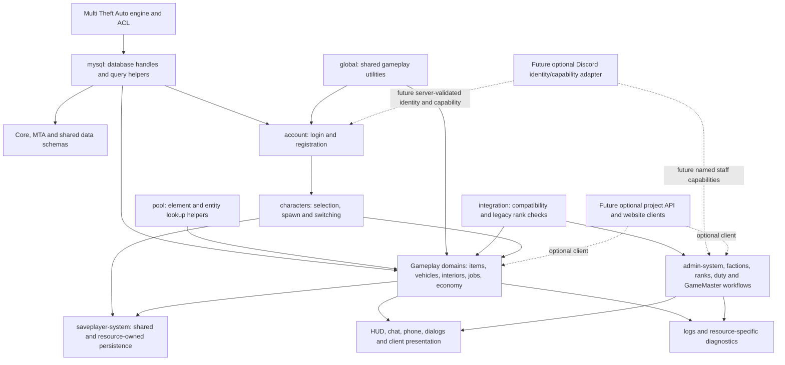

# Resource relationships and runtime boundaries

This map summarizes source-confirmed relationships found in the maintained resource dossiers. It is an orientation guide, not a complete call graph: dynamic exports, manifest startup order, and hidden database coupling can add edges. Use each linked dossier and the coverage ledger for file-level evidence. Runtime behavior is unverified unless a separate record says otherwise.

## Coverage and how to read this map

- The current census contains 179 resource manifests: 144 in the active tree and 35 in the archive.
- 135 rows have maintained dossiers, including 118 full static reviews and 17 partial reviews. Every one of those dossiers now has an individual [Script Resources discussion](../resources/README.md).
- 44 resources remain catalog-only: 14 in the active tree and 30 archived. A manifest entry is not a source audit or proof that a resource is enabled.
- `mtaserver.conf.bak` is a startup snapshot, not evidence of the live server configuration.

## Core layers

The account and gameplay data model spans separate `core` and `mta` schemas. Character selection loads server-owned state into the active session; `saveplayer-system` handles shared lifecycle saves while domain resources persist the data they own. Do not assume a character save covers every inventory, vehicle, property, job, or finance subsystem. The current database wrappers mix native MTA queries, shared exports, and a legacy external module; table ownership and transaction behavior need to be traced before schema migration.

## Reviewed gameplay paths and cross-resource edges

| Player/staff outcome | Source-confirmed path | Important boundary or open work |
|---|---|---|
| Authenticate and enter a character | `account` authenticates an account, then `account/s_characters.lua` selects and restores a character; `saveplayer-system` and domain resources persist later state. | Legacy registration crosses schemas and calls a missing local activation-mail service. Discord identity is planned, not the current active login path. See [account dossier](../resources/account.md), [identity design](DISCORD_AUTH_DESIGN.md), and Issues #2, #43, #68. |
| Use or move an inventory item | `item-system` owns item operations across players, vehicles, objects, peds, safes, and interiors; `item-world` handles world representations; dependent resources add specialized behavior. | Treat client inventory as presentation. Validate item owner, active character, destination, state, and proximity in server handlers. Review [item-system](../resources/item-system.md), [item-world](../resources/item-world.md), and [item-move](../resources/item-move.md) together. |
| Render custom item, vehicle, or animated-media textures | Item/artifact/vehicle callers register textures with `item-texture`; `vehicle_load` restores persisted vehicle definitions; `clubtec` consumes the animated catalog from `fakevideo`; `item-system` can request dimension reloads. | These features create server outbound requests and cache/stream data. Constrain URLs, payloads, pending requests, authorization, and cache growth; optional media providers must not become startup requirements. See [item-texture](../resources/item-texture.md), [fakevideo](../resources/fakevideo.md), [clubtec](../resources/clubtec.md), and Issues #447, #453–#455, #540. |
| Attach a player or vehicle to another vehicle | `glue-system` exposes client/server attachment events; `heligrab` implements helicopter hanging and exports data to possible callers. | The sender is not authority for arbitrary target/source elements, transform, range, capacity, or world. Bind operations to MTA's authenticated `client`, validate authoritative state, and clean up on disconnect/death/vehicle/resource lifecycle. See [glue-system](../resources/glue-system.md), [heligrab](../resources/heligrab.md), and Issues #448–#449. |
| Operate staff and GameMaster workflows | `integration` supplies legacy rank helpers; `admin-system` edits staff ranks; faction/rank/duty resources provide separate operational state; GameMaster data has its own legacy element data and incomplete grant flow. | `supporter_level` means donor/supporter tier and must not become moderation authority. Future Discord roles map to named capabilities at server boundaries; GameMaster, administrator, faction/duty, donor entitlement, and MTA ACL remain distinct. See [Discord authorization design](DISCORD_AUTH_DESIGN.md), [administration](ADMINISTRATION_CURRENT_STATE.md), and [forums](../resources/forums.md). |
| Read in-game telemetry or developer state | `ipb` samples server resource performance; `hardwaresurvey` aggregates screen resolution; `guied`, `object-browser`, `runcode`, and `sfxbrowser` are operator/developer utilities with different server/client authority. | Keep optional developer tools out of ordinary startup. `runcode` now has a source-level server caller/permission gate and bounded, code-free audit logs, but remains disabled pending disposable runtime and ACL verification (Issue #443); `guied` file access is tracked by #450. |

## Planned integrations stay outside gameplay core

Discord OAuth/identity should be implemented in a standalone service/plugin and integrated through a small server-side adapter. MTA resources should ask for a named capability or validated linked identity, never embed Discord secrets or hard-code role IDs. Role IDs remain blank operator configuration; donor tiers, staff roles, and GameMaster permissions stay separate. Revocation must invalidate the linked MTA session.

A project API can later serve an operator dashboard or custom website, but the gamemode must remain usable without either. The API should invoke the same server-owned domain operations as in-game controls rather than creating a second authority path. Logging sinks (database, webhooks, Grafana-compatible export, or media providers such as Fivemanage) remain optional adapters with safe disabled/offline behavior.

## Audit method and remaining scope

For each manifest, follow manifest-loaded scripts to remote events, commands, exports, direct callers, database tables, persistence, resource lifecycle, and player/staff/operator entry points. Record whether a relationship is declared, source-called, inferred, archive-only, or unknown. Keep source facts separate from proposals and runtime verification. Prioritize the 14 catalog-only active resources by identity, money, ownership, inventory, staff access, police/medical, persistence, and startup dependency before low-impact tools and archive comparisons.

See the [resource dossier index](../resources/README.md), [manifest catalog](../reference/RESOURCE_CATALOG.md), and [coverage ledger](../../RESOURCE_DOCUMENTATION_STATUS.csv) for per-resource status.
